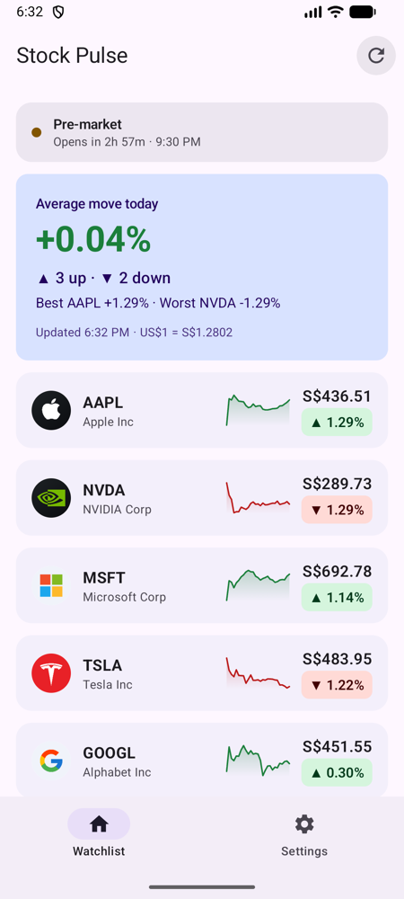
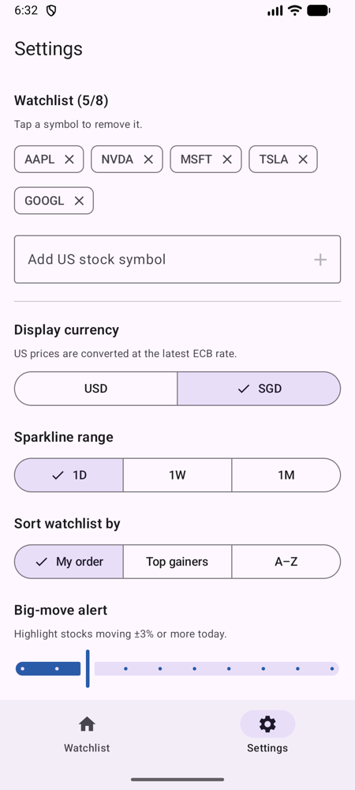
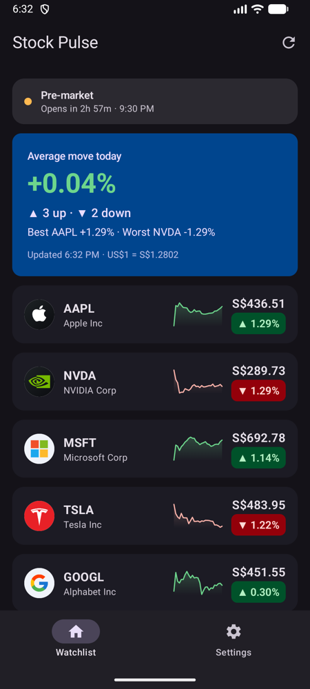

# Stock Pulse

**CP3406 Assessment 1 – Utility App** · Kotlin · Jetpack Compose · Material 3

Stock Pulse answers one question in about three seconds: **how are the stocks I care about doing right now?**
It is a focused, at-a-glance watchlist for US stocks, with prices shown in Singapore dollars,
the US market's open/close time converted to the user's own time zone, and an alert for unusually large moves.

| Watchlist | Settings | Dark theme |
|---|---|---|
|  |  |  |

---

## Core features

### Main screen (Utility)
| Feature | What the user sees at a glance |
|---|---|
| **Market status** | "Market open · Closes in 2h 15m · 4:00 AM". The countdown and closing time are shown in the user's local time, so a Singapore user doesn't have to convert from New York time |
| **Summary card** | One large number (the average move of the watchlist today), how many stocks are up or down, and the best and worst performers |
| **Big-move alert** | Highlights any stock moving by at least ±N% today (N is set in Settings) |
| **Stock rows** | Company logo, symbol, name, a **sparkline** of recent prices, the price in USD or SGD, and today's % change |
| **Freshness** | "Updated 6:32 PM · US$1 = S$1.2802". Data auto-refreshes, and you can also pull down or tap ⟳ to refresh |
| **Resilience** | If a refresh fails, the last prices stay on screen with a short notice. Unknown symbols are listed separately |

### Settings screen
Every setting changes what the main screen shows. Settings are kept in memory only; the spec doesn't require them to persist.

| Setting | Effect on main screen |
|---|---|
| Watchlist editor (max 8) | Add a symbol (checked live against Finnhub search) or tap a chip to remove it |
| Display currency USD / SGD | Converts all prices using the latest ECB rate |
| Sparkline range 1D / 1W / 1M | Changes the history drawn in each row |
| Sort by My order / Top gainers / A–Z | Reorders rows, with an animation |
| Big-move alert 1–10 % | Threshold for the alert card |
| Auto-refresh Off / 30s / 1m / 5m | Polling interval |

---

## Web APIs (Retrofit)

| API | Used for | Notes |
|---|---|---|
| [Finnhub](https://finnhub.io/docs/api) | `quote`, `stock/profile2` (name, logo), `stock/market-status`, `search` | Free tier: US stocks, ~60 calls/min |
| [Twelve Data](https://twelvedata.com/docs#time-series) | `time_series` for sparklines | Finnhub's free tier no longer includes candles. Batched request, 8 credits/min |
| [Frankfurter](https://frankfurter.dev) | USD→SGD rate | ECB data, no API key needed |

**How the APIs are used**

- **Parallel requests.** All requests for a refresh run in parallel with coroutines (`async`/`awaitAll`). One refresh of 5 stocks makes about 11 calls but takes as long as the slowest single call.
- **Rate-limit-aware caching.**
  - Company profiles are fetched once per session.
  - The FX rate is cached for 1 hour.
  - Sparklines are cached per range for 5 min (1D) to 6 h (1M), and only expired symbols are re-requested, in **one batched call**.
  - This keeps a 30-second auto-refresh within the free tiers.
- **Graceful degradation.**
  - Sparklines and FX are optional: if Twelve Data or Frankfurter fails, quotes still show, and the app falls back to USD with a note.
  - One bad symbol in a batch doesn't break the others.
- **Edge cases handled.** Each was found by calling the real APIs:
  - Twelve Data returns a differently shaped response for one symbol versus several (handled by `TwelveDataParser`).
  - Finnhub returns all zeros for an unknown symbol.
  - The 1D sparkline needs the previous close prepended, otherwise the overnight gap makes the line colour disagree with the day's change.
- **Key security.**
  - API keys are sent as HTTP headers (`X-Finnhub-Token`, `Authorization: apikey …`) by an OkHttp `Interceptor`, never in URLs.
  - The keys live in a git-ignored `.env` file and reach the code through `BuildConfig`.

---

## Architecture

```
UI (Compose)                    ViewModel                     Data
─────────────                   ─────────                     ────
UtilityApp (Scaffold + tabs)    StockViewModel                StockRepository ──► NetworkStockRepository
 ├─ UtilityScreen ◄─ uiState ───  settings ──┐                                     ├─ FinnhubApi      (Retrofit)
 │   └─ components/*            fetch flow ◄─┤ network-relevant                    ├─ TwelveDataApi   (Retrofit)
 └─ SettingsScreen ◄─ settings  combine ◄────┘ display-only                        └─ FrankfurterApi  (Retrofit)
                     ─ actions ─►  addSymbol / setX ──────────► SettingsRepository ─► InMemorySettingsRepository
                                                     AppContainer (manual DI) builds and wires everything
```

- **MVVM + Repository.**
  - The UI never touches an API.
  - `StockRepository` and `SettingsRepository` are interfaces, so tests use a fake and a DataStore version could be added later without changing the UI.
- **Manual dependency injection.** `StockPulseApplication` creates a `DefaultAppContainer` that builds a single shared `OkHttpClient`, the Retrofit services and the repositories. `StockViewModel.Factory` takes its dependencies from there.
- **Reactive, lifecycle-aware data flow** (`StockViewModel`):
  - Only *network-relevant* settings (symbols, chart range, refresh interval) restart fetching, using `distinctUntilChanged` + `flatMapLatest`.
  - *Display-only* settings (currency, sort, alert threshold) are applied by the pure `WatchlistUiMapper`, so changes are instant and use no network.
  - `stateIn(WhileSubscribed(5s))` + `collectAsStateWithLifecycle()` means polling **stops automatically** when the app is in the background or the Settings tab is open, and resumes with an immediate refresh.
  - Refresh triggers (initial, timer, user) are merged and `conflate`d, so a burst of triggers causes one extra fetch, not a queue.
  - The UI state is a data class, not a Loading/Success/Error sealed type, so the last good data can stay visible during a refresh or after a failure.

### Project structure
```
app/src/main/java/au/edu/jcu/assessment/utilityapp/
├── MainActivity.kt              UtilityApp(): Scaffold, top bar, bottom navigation
├── StockPulseApplication.kt     Creates the DI container
├── di/AppContainer.kt           Manual dependency injection
├── data/
│   ├── model/                   StockQuote, MarketStatus, WatchlistSnapshot, AppSettings + enums
│   ├── remote/                  Retrofit interfaces, DTOs, ApiKeyInterceptor, TwelveDataParser
│   └── repository/              StockRepository, NetworkStockRepository, SettingsRepository
├── domain/UsMarketHours.kt      NYSE/NASDAQ hours in New York time (DST-safe)
└── ui/
    ├── StockViewModel.kt        State + settings actions
    ├── WatchlistUiState.kt      UI models (rows, summary, errors, add-symbol state)
    ├── WatchlistUiMapper.kt     Pure: snapshot + settings → screen content
    ├── format/StockFormatters.kt
    ├── components/              StockRow, SparklineChart (Canvas), ChangeBadge, CompanyLogo,
    │                            MarketStatusBanner, WatchlistSummaryCard, BigMoveAlertCard, StatusViews
    ├── screens/                 UtilityScreen, SettingsScreen (stateful wrapper + stateless content)
    └── theme/                   Material 3 theme + MarketColors (gain/loss) via CompositionLocal
```

---

## Jetpack Compose and Material 3

- **Small, reusable composables**, each with a `@Preview` using `PreviewData`.
  - Screens are split into a stateful wrapper (gets the ViewModel) and a stateless `…Content` composable (previewable and testable).
- **Custom drawing.** `SparklineChart` draws the line and gradient fill directly on a `Canvas`.
- **Generic components.** `SegmentedSelector<T>` is used for every enum setting.
- **Material 3 components:**
  - `Scaffold`, `TopAppBar`, `NavigationBar`
  - `PullToRefreshBox`, `SingleChoiceSegmentedButtonRow`, `Slider`, `InputChip`, `FlowRow`
  - `Card` and `Surface` with tonal colours
- **Animated reordering.** `LazyColumn` uses stable keys and `Modifier.animateItem()`, so rows slide when the sort order changes.
- **Theme.**
  - Brand light and dark colour schemes.
  - Semantic `MarketColors` (gain/loss) are provided through a `CompositionLocal` and tuned for contrast in both themes.
- **Accessibility.**
  - Each row is read by TalkBack as one sentence ("NVDA, NVIDIA Corp. Price S$289.73. Down 1.29% today.").
  - Direction is shown with ▲/▼ as well as colour.
  - Headings are marked, and refresh errors use a polite live region.
- All user-facing text is in `strings.xml`.

---

## Getting started

1. Clone the repo and open it in Android Studio (minSdk 26, targetSdk 36).
2. Get two free API keys: [Finnhub](https://finnhub.io/register) and [Twelve Data](https://twelvedata.com/register).
3. Copy `.env.example` to `.env` in the project root and fill it in:
   ```
   FINNHUB_API_KEY=your_key
   TWELVE_DATA_API_KEY=your_key
   ```
4. Run the `app` configuration on an emulator or device (internet required).

### Tests
```
./gradlew testDebugUnitTest
```
There are 26 JVM unit tests. None need the network, because they use a `FakeStockRepository`. They cover:
- `WatchlistUiMapperTest`: currency conversion and fallback, sorting, big-move threshold, summary, 1D sparkline gap
- `StockViewModelTest`: initial load; display settings don't hit the network; refresh; errors keep the last good data; add-symbol validation
- `UsMarketHoursTest`: next open across weekends and the US daylight-saving change
- `TwelveDataParserTest`: single vs batched responses, per-symbol and request-level errors
- `StockFormattersTest`: prices, percentages, countdowns, local times

---

## Limitations and possible improvements
- Free API tiers cover **US stocks only**; SGX stocks would need a paid plan.
- Prices may be delayed, and the app is **not financial advice**.
- Market holidays are shown live from Finnhub, but the "next open" countdown doesn't skip future holidays.
- Settings are not persisted (as allowed by the spec). `SettingsRepository` is an interface, so a DataStore version could be added later.

## Acknowledgement of AI assistance
Generative AI (Claude) was used while building this project to help with Kotlin/Compose code and API exploration,
as permitted for this assessment. Its use is declared in the submitted *Declaration of AI-Generated Material*.
